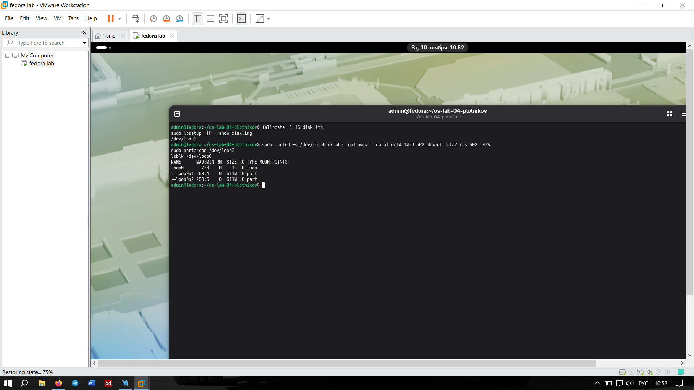
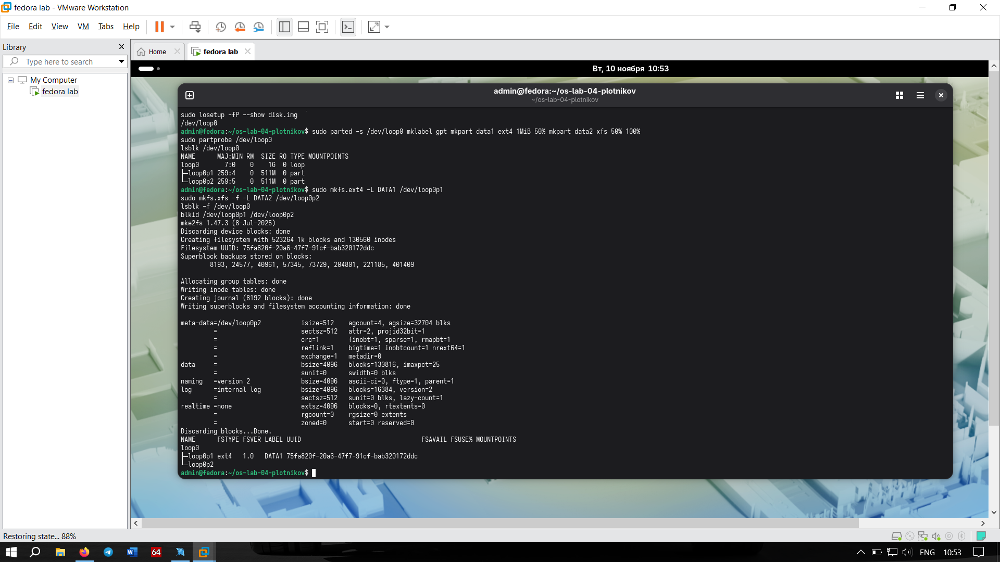
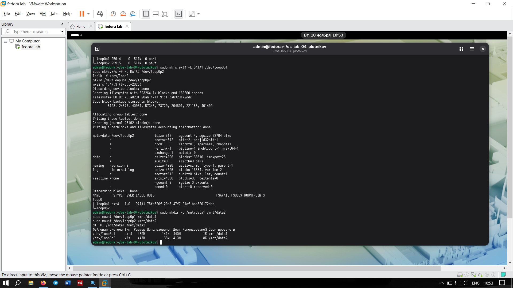

# Задание 1. Создание диска, разметка, ФС

## Что мутили
Создали файл-образ на 1 ГБ (`disk.img`) и подключили его как `/dev/loop0`. Разметили через `parted` в GPT, создали два раздела (p1 и p2). На первый накатили `ext4` (с меткой DATA1), на второй — `xfs` (с меткой DATA2). Оба успешно примонтировали в `/mnt/data1` и `/mnt/data2`.

## Отвечаем на вопросы
**Почему ext4-раздел сразу занят на несколько процентов, хотя мы ничего не записали?**
Потому что при создании ФС ext4 сразу выделяет место под свои служебные структуры: суперблок (superblock), журнал (journal), таблицу inode и папку `lost+found` (для восстановления файлов после сбоев). В `df -h` это видно как занятые мегабайты.

## Cкриншоты

