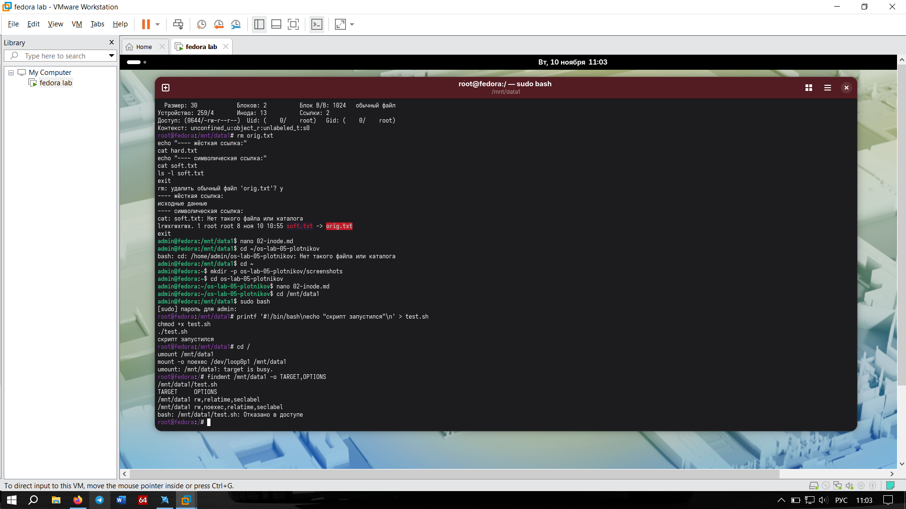

# Задание 3. Монтирование и опция noexec 

## Что мутили
Создали скрипт `test.sh` с правами на исполнение (`chmod +x`) и успешно запустили его (он вывел "скрипт запустился"). Затем перемонтировали раздел `/dev/loop0p1` в `/mnt/data1` с опцией `noexec` и попытались запустить тот же скрипт. Система выдала `Permission denied` (Отказано в доступе), хотя файл на месте и права `+x` никто не отменял.

## Отвечаем на вопросы
**Как это связано с лекцией: почему noexec на /tmp помешал бы вредоносу, который туда скачали?**
Папка `/tmp` доступна для записи всем пользователям. Хакеры часто скачивают туда свои вредоносные скрипты и бинарники. Если администратор примонтировал `/tmp` с опцией `noexec`, то ядро просто запретит запускать любые программы из этой папки, даже если малварь успешно скачалась. 

**Какие ещё опции (nosuid, nodev) и зачем рекомендуют для /tmp?**
*   `nosuid` — запрещает действие SUID-бита. То есть вредоносная программа не сможет стать рутом, даже если на ней стоит SUID.
*   `nodev` — запрещает интерпретировать файлы как устройства (нельзя создать в `/tmp` файл, который система примет за жесткий диск или терминал).
Для `/tmp` обычно используют связку: `noexec,nosuid,nodev`.

## Скриншоты

