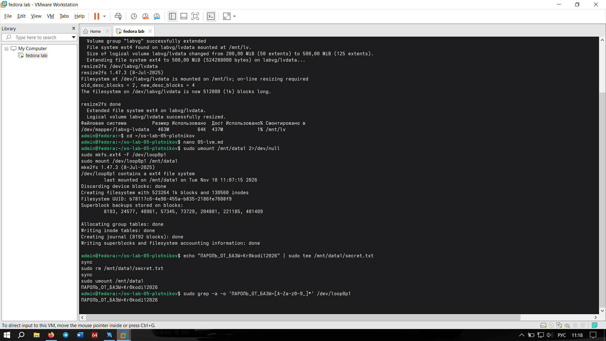
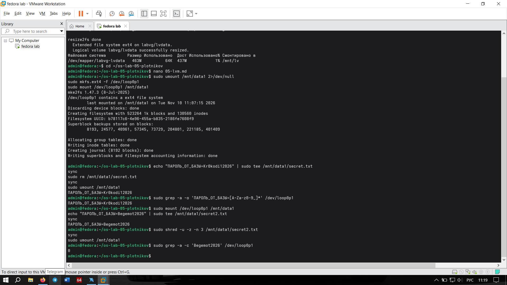

# Задание 6. Удалённый файл и его уничтожение

## Что мутили
Записали пароль в файл `secret.txt`, удалили через `rm` и просканировали сырое устройство (`/dev/loop0p1`) через `grep`. Пароль нашелся! 
Затем записали второй пароль в `secret2.txt`, уничтожили его через `shred` (с перезаписью) и снова просканировали. Второй пароль не нашелся (вывод `0`).

## Отвечаем на вопросы
**Что физически делает rm, а что — shred?**
*   `rm` (remove) — просто удаляет запись об файле из каталога и освобождает inode. Сами блоки данных на диске остаются нетронутыми до тех пор, пока туда не запишут что-то новое. Данные можно легко восстановить специальными утилитами.
*   `shred` — перед удалением файла несколько раз перезаписывает его блоки случайными данными (`-n 3` значит 3 прохода) и затирает нулями (`-z`). После этого восстановить данные физически невозможно.

**Почему на SSD вместо shred надёжнее шифровать весь диск?**
Контроллер SSD использует механизм выравнивания износа (wear leveling). Он сам решает, в какие физические ячейки памяти записать данные. Когда `shred` пытается перезаписать сектор, контроллер может записать новые данные в другие ячейки, а старые (с паролем) оставить в резерве. Поэтому `shred` на SSD может затереть не те блоки. Надежнее использовать полнодисковое шифрование (LUKS) — тогда без ключа данные на диске превращаются в мусор.

**Что нужно сделать со старым диском перед тем, как его выбросить?**
Для HDD — надежно затереть через `shred` или `dd` (записать нули). Для SSD — сделать `secure erase` через утилиты производителя (ATA Secure Erase) или физически уничтожить чипы памяти (разобрать и сломать).

## Скриншоты

